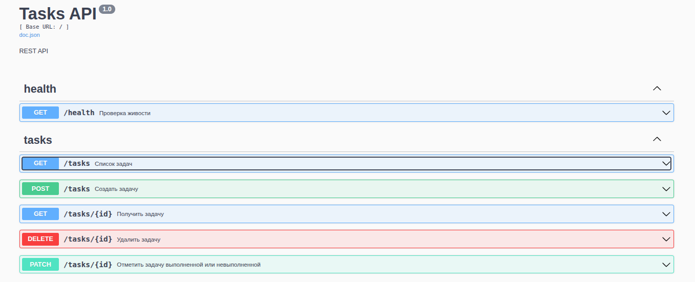

# Как запускать:

## В Docker Compose

Для `make up` нужны Docker Compose и Go на хосте. Go собирает утилиту для миграций.

1. Выполните `cp .env.example .env` и заполните `DB_USER` и `DB_PASSWORD` в `.env`.
2. Запустите `make up`. Команда поднимет PostgreSQL, применит миграции и запустит API.

Compose передаёт `DB_PASSWORD` из `.env` в контейнеры через secret `db_password`. PostgreSQL и API читают его из `/run/secrets/db_password`. Для уже инициализированного тома укажите действующие логин и пароль PostgreSQL.

## На хосте
Приложение запускается прямо на машине через `go run`, в докере остаётся только БД. Нужен установленный Go.

1. Создайте .env файл так же, как для докера
2. В .env поменяйте `DB_HOST=db` на `DB_HOST=localhost`
3. Выставьте `DB_PORT` равным `DB_EXPOSED_PORT` — это порт, на котором БД доступна с хоста
4. Поднимите БД: `docker compose up -d --wait db`
5. Накатите миграции: `make migrate-up`
6. Если приложение уже запущено в докере, остановите его, чтобы освободить порт: `docker compose stop app`
7. Запустите `make run`
8. Проверьте: `curl localhost:8080/health`

Хост нужно менять руками: `db` — это имя сервиса внутри сети докера, с хоста оно не резолвится. `make run` берёт переменные из .env как есть и ничего не подменяет, поэтому с `DB_HOST=db` приложение на хосте не подключится к базе.

Перед возвратом к запуску в докере верните `DB_HOST=db`.

## ДЗ №2. Развёртывание в Kubernetes

- [k8s/app.yaml](k8s/app.yaml) описывает Deployment `tasks-api` и внутренний Service `tasks-api` на порту `8080`. Приложение подключается к `postgres:5432` по DNS-имени сервиса базы. HTTP-проверка `/health` помечает API готовым, когда доступна БД.
- [k8s/postgres.yaml](k8s/postgres.yaml) описывает StatefulSet и headless Service `postgres`. Из `volumeClaimTemplates` StatefulSet создаёт PVC `data-postgres-0` на 1 ГиБ в классе хранения `local-path`. После замены Pod PostgreSQL снова монтирует этот том.
- [kustomization.yaml](kustomization.yaml) собирает ресурсы в namespace `sosister-rap-star` и создаёт ConfigMap из [миграции ДЗ №1](migrations/000001_init.up.sql). Init-контейнер ждёт PostgreSQL и применяет миграцию транзакционно перед запуском API.
- Образ API `ghcr.io/sosisterrapstar/irvs-tasks:hw2` собирается из [Dockerfile ДЗ №1](Dockerfile) через [GitHub Actions](../.github/workflows/tasks-image.yml). PostgreSQL и API получают один пароль из Secret `postgres-auth`.

### Запуск

Выполните команды из корня репозитория. Secret нужно создать один раз. Для уже инициализированного тома используйте действующие учётные данные PostgreSQL.

```sh
cfg="$HOME/Downloads/Telegram Desktop/students.yaml"
k() { kubectl --kubeconfig="$cfg" -n sosister-rap-star "$@"; }

(
  db_password=$(openssl rand -hex 24) || exit 1
  printf 'POSTGRES_USER=irvs_k8s\nPOSTGRES_DB=app\nPOSTGRES_PASSWORD=%s\n' "$db_password"
) | k create secret generic postgres-auth --from-env-file=/dev/stdin

k apply -k ids_1
k rollout status statefulset/postgres --timeout=180s
k rollout status deployment/tasks-api --timeout=180s
k get pods,svc,pvc
```

### Проверка сохранности данных

Откройте порт API в отдельном терминале. Swagger UI будет доступен по адресу `http://127.0.0.1:8080/swagger/index.html`.

```sh
kubectl --kubeconfig="$HOME/Downloads/Telegram Desktop/students.yaml" \
  -n sosister-rap-star port-forward svc/tasks-api 8080:8080
```

В первом терминале создайте задачу через API, запомните UID Pod и PVC, затем удалите Pod базы. Для извлечения `id` из JSON нужен `python3`.

```sh
api=http://127.0.0.1:8080
created=$(curl -fsS -H 'Content-Type: application/json' \
  -d '{"title":"IRVS HW2 persistence check"}' "$api/tasks")
printf '%s\n' "$created"
task_id=$(printf '%s\n' "$created" | python3 -c 'import json, sys; print(json.load(sys.stdin)["id"])')

old_pod_uid=$(k get pod postgres-0 -o jsonpath='{.metadata.uid}')
old_pvc_uid=$(k get pvc data-postgres-0 -o jsonpath='{.metadata.uid}')
k delete pod postgres-0
k wait --for=create pod/postgres-0 --timeout=180s
k wait --for=condition=Ready pod/postgres-0 --timeout=180s
k wait --for=condition=Available deployment/tasks-api --timeout=180s

new_pod_uid=$(k get pod postgres-0 -o jsonpath='{.metadata.uid}')
new_pvc_uid=$(k get pvc data-postgres-0 -o jsonpath='{.metadata.uid}')
stored=$(curl -fsS --retry 10 --retry-delay 2 "$api/tasks/$task_id")
printf 'Pod: %s → %s\nPVC: %s → %s\n%s\n' \
  "$old_pod_uid" "$new_pod_uid" "$old_pvc_uid" "$new_pvc_uid" "$stored"
test "$old_pod_uid" != "$new_pod_uid" &&
  test "$old_pvc_uid" = "$new_pvc_uid" &&
  test "$created" = "$stored"
```

UID Pod меняется, UID PVC остаётся прежним, а `GET /tasks/{id}` возвращает ту же запись, что и `POST /tasks`.

# Скриншоты

## Swagger UI
Доступен после запуска по адресу http://localhost:8080/swagger/index.html



## Подключение к БД с хоста
Параметры для клиента БД: хост `localhost`, порт — `DB_EXPOSED_PORT`, база, пользователь и пароль — из .env.


# Лицензия

[MIT](LICENSE)
