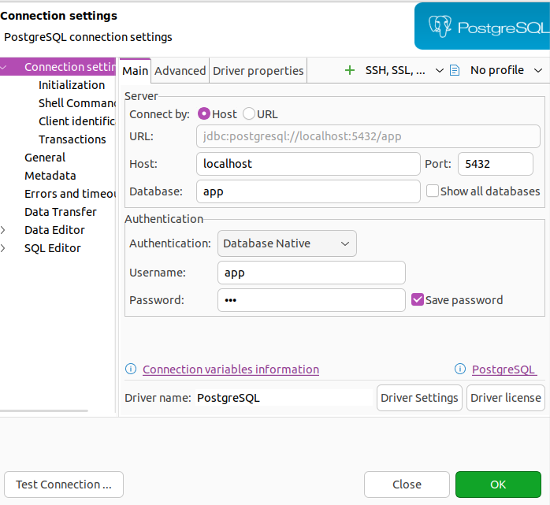

# Как запускать:

## В Docker Compose

Для `make up` нужны Docker Compose и Go на хосте. Go собирает утилиту для миграций.

1. Выполните `cp .env.example .env` и заполните `DB_USER` и `DB_PASSWORD` в `.env`.
2. Запустите `make up`. Команда поднимет PostgreSQL, применит миграции и запустит API.

Compose передаёт `DB_PASSWORD` из `.env` в контейнеры через secret `db_password`. PostgreSQL и API читают его из `/run/secrets/db_password`. Для уже инициализированного тома укажите действующие логин и пароль PostgreSQL.

## На хосте
Приложение запускается прямо на машине через `go run`, в докере остаётся только БД. Нужен установленный Go.

1. Создайте .env файл так же, как для докера
2. В .env поменяйте `DB_HOST=db` на `DB_HOST=localhost`
3. Выставьте `DB_PORT` равным `DB_EXPOSED_PORT` — это порт, на котором БД доступна с хоста
4. Поднимите БД: `docker compose up -d --wait db`
5. Накатите миграции: `make migrate-up`
6. Если приложение уже запущено в докере, остановите его, чтобы освободить порт: `docker compose stop app`
7. Запустите `make run`
8. Проверьте: `curl localhost:8080/health`

Хост нужно менять руками: `db` — это имя сервиса внутри сети докера, с хоста оно не резолвится. `make run` берёт переменные из .env как есть и ничего не подменяет, поэтому с `DB_HOST=db` приложение на хосте не подключится к базе.

Перед возвратом к запуску в докере верните `DB_HOST=db`.

## PostgreSQL в Kubernetes

Манифест [k8s/postgres.yaml](k8s/postgres.yaml) создаёт StatefulSet с одной репликой и headless Service `postgres`. Для Pod `postgres-0` Kubernetes выделяет PVC `data-postgres-0` через StorageClass кластера по умолчанию. Подготовьте `.env` с заполненными `DB_USER`, `DB_PASSWORD` и `DB_NAME`.

```sh
kubectl create namespace irvs
(
  . ./.env
  printf 'POSTGRES_USER=%s\nPOSTGRES_PASSWORD=%s\nPOSTGRES_DB=%s\n' \
    "$DB_USER" "$DB_PASSWORD" "$DB_NAME"
) | kubectl -n irvs create secret generic postgres-auth --from-env-file=/dev/stdin
kubectl -n irvs apply -f k8s/postgres.yaml
kubectl -n irvs rollout status statefulset/postgres --timeout=120s
```

Чтобы проверить постоянство данных, добавьте запись, пересоздайте Pod и прочитайте её снова.

```sh
kubectl -n irvs exec -i postgres-0 -- sh -ec \
  'psql -v ON_ERROR_STOP=1 -U "$POSTGRES_USER" -d "$POSTGRES_DB"' <<'SQL'
CREATE TABLE IF NOT EXISTS persistence_check (id integer PRIMARY KEY);
INSERT INTO persistence_check VALUES (1) ON CONFLICT DO NOTHING;
SQL

old_pod_uid=$(kubectl -n irvs get pod postgres-0 -o jsonpath='{.metadata.uid}')
kubectl -n irvs delete pod postgres-0
kubectl -n irvs wait --for=create pod/postgres-0 --timeout=120s
kubectl -n irvs wait --for=condition=Ready pod/postgres-0 --timeout=120s
test "$old_pod_uid" != "$(kubectl -n irvs get pod postgres-0 -o jsonpath='{.metadata.uid}')"
kubectl -n irvs exec postgres-0 -- sh -ec \
  'psql -v ON_ERROR_STOP=1 -U "$POSTGRES_USER" -d "$POSTGRES_DB" -Atc "SELECT id FROM persistence_check"'
```

Последняя команда должна вывести `1`.

# Скриншоты

## Swagger UI
Доступен после запуска по адресу http://localhost:8080/swagger/index.html


## Подключение к БД с хоста
Параметры для клиента БД: хост `localhost`, порт — `DB_EXPOSED_PORT`, база, пользователь и пароль — из .env.



# Лицензия

[MIT](LICENSE)
