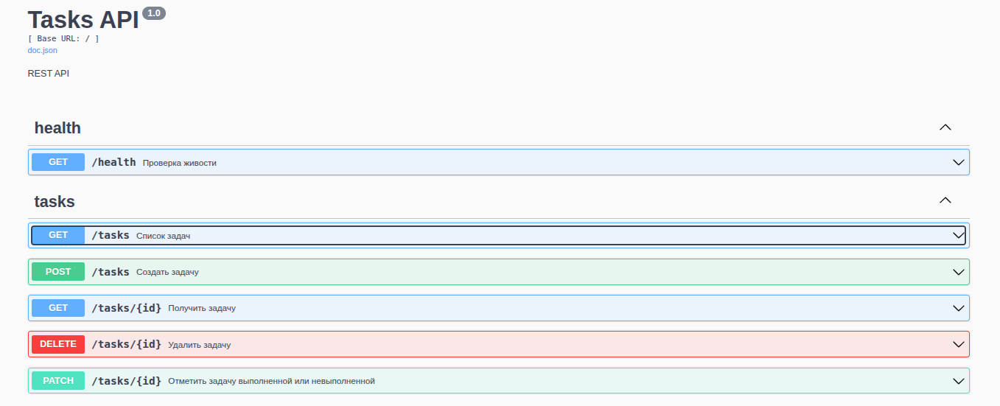
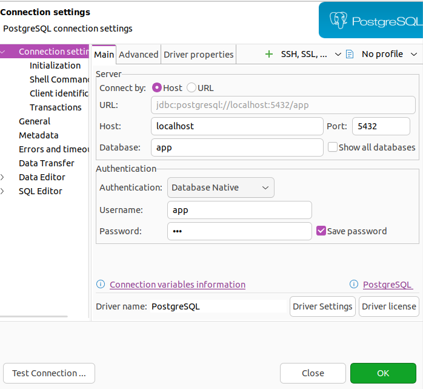

# Как запускать:

## В докере 
1. Создайте .env файл 
2. Скопируйте из .env.example содержимое в .env
3. Выставите параметры 
4. Запустите make up

## На хосте
Приложение запускается прямо на машине через `go run`, в докере остаётся только БД. Нужен установленный Go.

1. Создайте .env файл так же, как для докера
2. В .env поменяйте `DB_HOST=db` на `DB_HOST=localhost`
3. Выставьте `DB_PORT` равным `DB_EXPOSED_PORT` — это порт, на котором БД доступна с хоста
4. Поднимите БД: `docker compose up -d --wait db`
5. Накатите миграции: `make migrate-up`
6. Если приложение уже запущено в докере, остановите его, чтобы освободить порт: `docker compose stop app`
7. Запустите `make run`
8. Проверьте: `curl localhost:8080/health`

Хост нужно менять руками: `db` — это имя сервиса внутри сети докера, с хоста оно не резолвится. `make run` берёт переменные из .env как есть и ничего не подменяет, поэтому с `DB_HOST=db` приложение на хосте не подключится к базе.

Перед возвратом к запуску в докере верните `DB_HOST=db`.

# Скриншоты

## Swagger UI
Доступен после запуска по адресу http://localhost:8080/swagger/index.html

## Подключение к БД с хоста
Параметры для клиента БД: хост `localhost`, порт — `DB_EXPOSED_PORT`, база, пользователь и пароль — из .env.

# Лицензия

[MIT](LICENSE)
